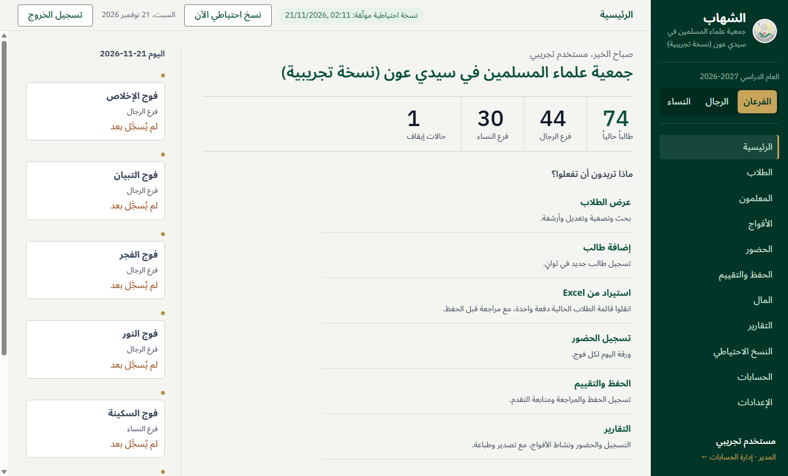
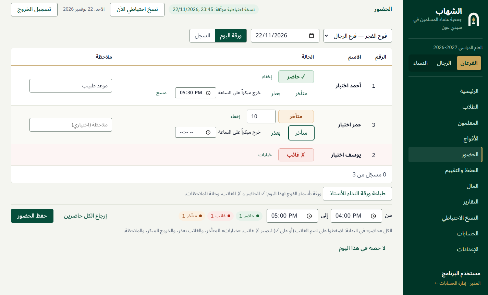
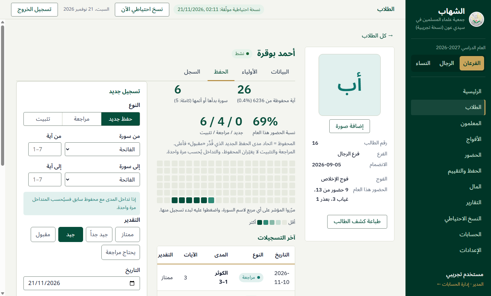
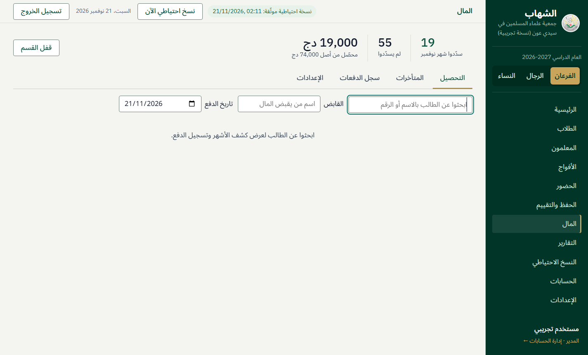
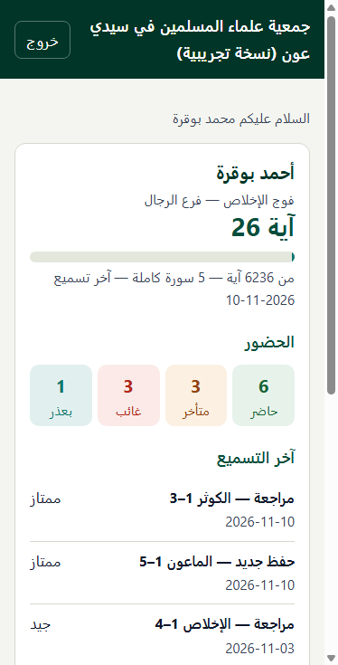

<div align="center">


# الشهاب
### مِشكاة · MISHKAT

**برنامج لإدارة الجمعيات والمدارس القرآنية: يعمل على ويندوز دون إنترنت، وبياناتكم تبقى عندكم.**




</div>

<div dir="rtl">

## ما هو الشهاب؟

برنامج عربي لإدارة شؤون الجمعية القرآنية اليومية: الطلاب والأولياء، والأفواج والمعلمون، والحضور، ومتابعة الحفظ بخريطة السور، والرسوم الشهرية مع وصل الاستلام، والتقارير والطباعة. يُثبَّت على حاسوب الجمعية ويعمل **دون إنترنت**، وكل البيانات تبقى على ذلك الحاسوب.

> النسخة الحالية **تجريبية** (0.1.0) وتُجرَّب مع جمعية واحدة بفرعين (رجال ونساء) وأكثر من 200 طالب.

## المميزات

| | |
|---|---|
| 👥 **الطلاب والأولياء** | ملف لكل طالب، أرشفة واستعادة، استيراد قائمة الطلاب والأولياء من Excel مع مراجعة الأخطاء قبل الحفظ، وتصدير Excel و XML. |
| 🕌 **الأفواج والمعلمون** | أفواج لكل فرع، ربط المعلمين، تسجيل الطلاب ونقلهم بين الأفواج مع حفظ التاريخ. |
| ✅ **الحضور** | الكل «حاضر» تلقائياً واضغطة واحدة للغائب، والتأخر والخروج المبكر والملاحظات، وورقة نداء مطبوعة للأستاذ، وتصحيح مسجَّل بالسبب. |
| 📖 **الحفظ والتقييم** | حفظ جديد ومراجعة وتثبيت بمرجع السورة والآية، والمحفوظ يُحسب **اتحاد مقاطع** لا جمع أعداد، وخريطة ملوّنة لـ 114 سورة. |
| 💰 **الرسوم الشهرية** | قسم محمي بكلمة سر، تسجيل الدفعات، وصل استلام مرقّم، المتأخرات، والإلغاء بسبب دون حذف. |
| 📊 **التقارير والطباعة** | التسجيل والحضور ونشاط الأفواج، وكشف الطالب، بالعربية على ورق A4. |
| 🔐 **الأمان** | حسابات لكل شخص بصلاحيات وفروع، سجل نشاط لا يُعدَّل، مفتاح استرداد، ونسخ احتياطية **مشفّرة** تلقائية. |
| 📱 **الهاتف (تجريبي)** | الأساتذة يسجّلون الحضور والحفظ من هواتفهم عبر واي فاي الجمعية، وصفحة للأولياء لمتابعة أبنائهم، دون إنترنت. |

## صور من البرنامج

<p align="center"><i>كل الأسماء والأرقام في الصور وهمية.</i></p>

| الحضور | الحفظ وخريطة السور |
|---|---|
|  |  |
| **الرسوم الشهرية** | **صفحة الأولياء على الهاتف** |
|  |  |

## التجربة

1. ثبّتوا البرنامج (`Mishkat-Setup-0.1.0.exe`). يظهر تحذير ويندوز لأن البرنامج غير موقَّع رقمياً بعد: «More info» ثم «Run anyway».
2. أول تشغيل: معالج إعداد، والحساب الجاهز `admin` / `admin`، ثم يُطلب اختيار كلمة مرور جديدة واحتفظوا بورقة **مفتاح الاسترداد**.
3. جرّبوا بالملف الوهمي [`docs/samples/بيانات-الجمعية-تجريبي.xlsx`](docs/samples) أو بالقالب الفارغ لبياناتكم.

الدليل الكامل بالعربية: [`docs/handoff/TRIAL_GUIDE_AR.pdf`](docs/handoff/TRIAL_GUIDE_AR.pdf) · قائمة الاختبار: [`docs/handoff/SELF_TEST_AR.pdf`](docs/handoff/SELF_TEST_AR.pdf)

## للمطوّرين

```bash
npm install          # المكتبات
npm test             # كل الاختبارات (Vitest)
npm run typecheck    # فحص TypeScript
cd apps/desktop
npm run start        # تشغيل البرنامج للتطوير
node scripts/package.mjs   # بناء مثبّت ويندوز في apps/desktop/out/installer
```

**التقنيات:** TypeScript · Electron · React · SQLite (WAL، STRICT) · Vitest

```
apps/desktop      برنامج الحاسوب (Electron): الشاشات، والقناة الآمنة، والطباعة، ونسخة الهاتف
packages/domain   قواعد العمل الخالصة (لا تعتمد على شيء)
packages/db       قاعدة البيانات، والترحيلات، والنسخ الاحتياطي المشفّر، والحسابات
packages/files    قراءة وكتابة Excel و CSV و XML
packages/ui       ألوان الهوية وفحص التباين
docs/             المتطلبات، والمعمارية، وقواعد العمل، والقرارات المفتوحة، والأدلة
```

## حالة المشروع

- ✅ نسخة الحاسوب تعمل وتُجرَّب مع الجمعية.
- ⏳ بوابة الأولياء عبر الإنترنت، والتوقيع الرقمي، والتحديث التلقائي: لاحقاً.
- القرارات التي لم تُحسم بعد مسجّلة في [`docs/OPEN_DECISIONS.md`](docs/OPEN_DECISIONS.md).

## الخصوصية

البرنامج لا يتصل بالإنترنت ولا يرسل بيانات الطلاب إلى أي جهة. تخزين بيانات الأطفال وأرقام الأولياء وصورهم يحتاج مراجعة قانونية قبل الاعتماد النهائي.

## الرخصة

لم تُحدَّد رخصة الاستعمال بعد. كل الحقوق محفوظة لصاحب المشروع إلى أن تُضاف رخصة.

</div>

---

<details>
<summary><b>English</b></summary>

**Al-Shihab (MISHKAT)** is an Arabic-first, offline Windows desktop app for managing Quranic associations and schools: students and guardians, groups and teachers, attendance, Quran memorization tracking (exact surah/ayah ranges, union of ranges), monthly fees with receipts, reports and printing, named accounts with branch scoping, an append-only audit log, and encrypted automatic backups. A trial phone page over the association's Wi-Fi lets teachers record attendance and guardians follow their children, with no internet.

Status: trial version 0.1.0, piloted with one association (two branches, 200+ students). Stack: TypeScript, Electron, React, SQLite, Vitest. License: not chosen yet; all rights reserved until one is added.

</details>
