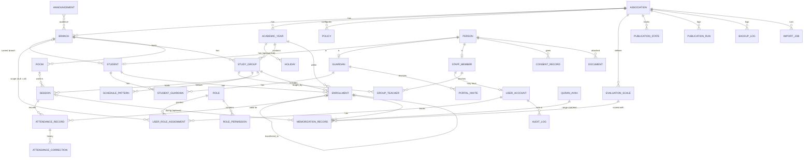

# DATABASE_DESIGN.md

**Accountable role:** Database Architect · **Status:** Batch 3 draft · **Date:** 2026-11-20

**Definition of Done:** a complete conceptual ERD; every table has purpose, key columns, constraints, and indexes; each database-level business rule (BR "DB" layer) is mapped to a concrete constraint; tenant and branch isolation are specified for both databases; sync-readiness is guaranteed by a mandatory row envelope; lifecycle (migrations, retention, backup) is defined. SQL shown is **illustrative design**, not application code; column lists marked "OD-013" will change when the field decision is made.

**Status legend:** **C** Confirmed · **R** Recommended · **U** Unresolved (named OD).

---

## 1. Two databases, two purposes

| Database | Engine | Authority | Contents |
|---|---|---|---|
| **Local** (association PC) | SQLite (WAL, `foreign_keys=ON`, STRICT tables) | **Authoritative** for all association data | Full domain model |
| **Portal** (cloud) | PostgreSQL with row-level security | Authoritative only for portal credentials; otherwise a **projection** | Minimal read model |

The local database holds **one association** but still carries `tenant_id` everywhere (BR-046) so data can be published, merged into a multi-tenant cloud later, or restored into another installation without schema change.

## 2. Mandatory row envelope (sync-ready)

Every domain table has these columns (BR-046, ADR-005):

| Column | Type | Rule |
|---|---|---|
| `id` | TEXT (UUIDv7, lowercase canonical) | PK; no auto-increment |
| `tenant_id` | TEXT NOT NULL | Equals the association id; never null |
| `version` | INTEGER NOT NULL DEFAULT 1 | Incremented on every update (optimistic concurrency, change detection) |
| `created_at`, `updated_at` | TEXT (UTC ISO-8601) NOT NULL | Set by the application clock |
| `created_by`, `updated_by` | TEXT NOT NULL | User id (or `system:<job>`) |
| `deleted_at`, `deleted_by` | TEXT NULL | **Tombstone**; rows are not physically deleted by the app |

**Exceptions:** (1) Quran reference tables (read-only dataset, versioned). (2) `audit_log` (append-only; local ordering key `seq` is allowed because it is never synced as an entity). (3) `schema_migration`.

**Formats:** dates `YYYY-MM-DD` (association timezone); times `HH:MM`; timestamps UTC `YYYY-MM-DDTHH:MM:SS.sssZ`; booleans INTEGER 0/1 with CHECK; enums TEXT with CHECK lists; money not stored in release 1.

## 3. Conceptual ERD



`QURAN_SURAH`/`QURAN_AYAH` are reference data (not tenant-owned). Names avoid SQL reserved words (`STUDY_GROUP`, not `GROUP`).

## 4. Tables

Legend for "Constraints": **PK/FK**, **U** unique, **CHK** check, **TRG** trigger (only where a declarative constraint cannot express it). All FKs include `tenant_id` implicitly through the envelope; **composite FKs include `tenant_id`** in the portal (see §8).

### 4.1 Association and calendar

| Table | Purpose | Key columns | Constraints / notes |
|---|---|---|---|
| `association` | The tenant | name, timezone (default `Africa/Algiers`), logo_ref, address, contact, locale settings | One row locally; `id = tenant_id` |
| `branch` | Branch (men's, women's, …) | name, label (free text), position, active | U(tenant_id, name) among live rows. **No gender column** (OD-022 default) |
| `academic_year` | School year | name, start_date, end_date, status (`planned/active/closed`) | CHK(start < end); **U partial: one `active` per tenant** (BR-016); no overlapping years (TRG or domain) |
| `holiday` | Confirmed non-teaching days | academic_year_id NULL, from_date, to_date, name, hijri_label NULL | Gregorian stored (ADR-013); CHK(from ≤ to) |
| `policy` | Configurable parameters (BR §11) | key, value_json, scope (association/branch), valid_from | Versioned: new row per change, never in-place; audited |
| `evaluation_scale` | Scale definition | version, name, definition_json (levels, labels, numeric value, pass mark flag) | Immutable once used; records point to the version (BR-036) |

### 4.2 People and access

| Table | Purpose | Key columns | Constraints / notes |
|---|---|---|---|
| `person` | Name and basic identity | given_name, family_name, display_name_latin NULL, gender NULL, birth_date NULL, phone NULL, address NULL | Fields beyond names are **OD-013**; no national ID by default (BR-022) |
| `student` | Student role of a person | person_id, student_no, branch_id, status (OD-023), joined_on, archived_at NULL, archive_reason NULL | U(person_id); U(tenant_id, student_no); CHK(status in list); archived students stay queryable (BR-019) |
| `guardian` | Guardian role of a person | person_id, notes NULL | U(person_id); **no credentials here** (BR-020) |
| `student_guardian` | Many-to-many link | student_id, guardian_id, relationship, is_emergency, portal_consent (0/1) | U(student_id, guardian_id); portal_consent gates publishing (BR-042) |
| `staff_member` | Teacher/staff role | person_id, kind (`employee/volunteer`), qualifications NULL, active | U(person_id) |
| `user_account` | Desktop login | staff_member_id, username, password_hash, status, failed_attempts, locked_until, last_login_at | U(tenant_id, username); hash algorithm per Batch 4; **never leaves the machine** |
| `role` | Role definition | name, is_system | Seeded roles per roles doc |
| `role_permission` | Permission grants | role_id, permission_code | U(role_id, permission_code) |
| `user_role_assignment` | Who has which role where | user_id, role_id, branch_id NULL | NULL branch = all branches (Director only, TRG/domain); U(user_id, role_id, branch_id) |
| `portal_invite` | One-time guardian invite (desktop side) | guardian_id, code_hash, expires_at, redeemed_at NULL, revoked_at NULL | Only the hash is stored; code shown once (WF-12) |
| `consent_record` | Evidence of consent | person_id, purpose (`portal/photo/document`), granted_at, withdrawn_at NULL, recorded_by | Required before photo/document storage and portal publication (BR-022, BR-042) |
| `document` | Attachment metadata | person_id, kind, file_ref, sha256, size, uploaded_by | Files stored on disk under the data folder, referenced by relative path + hash; upload limits and type allow-list (Batch 4) |

### 4.3 Groups, scheduling

| Table | Purpose | Key columns | Constraints / notes |
|---|---|---|---|
| `study_group` | Halaqa | branch_id, academic_year_id, name, level NULL, capacity, status | CHK(capacity > 0); U(branch_id, academic_year_id, name); **U(id, branch_id)** for composite references |
| `group_teacher` | Teacher assignments (multiple groups allowed, BR-003) | group_id, staff_member_id, role (`primary/assistant`), from_date, to_date NULL | History kept; overlapping primary assignments checked in domain |
| `room` | Rooms | branch_id, name | U(branch_id, name) |
| `schedule_pattern` | Weekly recurrence | group_id, weekday (0–6), start_time, end_time, room_id NULL, teacher_id NULL, valid_from, valid_to NULL | CHK(start < end) |
| `session` | One meeting | group_id, branch_id, session_date, start_time, end_time, room_id NULL, teacher_id NULL, status (`scheduled/held/cancelled`), cancel_reason NULL, confirmed_at NULL, confirmed_by NULL, pattern_id NULL | **U(id, group_id)**; U(group_id, session_date, start_time); CHK(cancelled ⇒ reason). `confirmed_at` = BR-030 "recorded". Conflicts (BR-024) enforced in domain + validated by query; exclusion constraints are not available in SQLite |

### 4.4 Enrollment

| Table | Purpose | Key columns | Constraints / notes |
|---|---|---|---|
| `enrollment` | Student ↔ group history | student_id, group_id, branch_id, academic_year_id, start_date, end_date NULL, end_reason NULL, transferred_to_id NULL | **U partial `(student_id, academic_year_id) WHERE end_date IS NULL AND deleted_at IS NULL` ⇒ BR-001**; **U(id, student_id, group_id)** for composite FKs; CHK(end_date ≥ start_date); FK (group_id, branch_id) → study_group(id, branch_id) (branch cannot drift); TRG: year of enrollment = group's year; overlapping date ranges for the same student/year rejected (BR-002) |

### 4.5 Attendance

| Table | Purpose | Key columns | Constraints / notes |
|---|---|---|---|
| `attendance_record` | One status per student per session | session_id, student_id, group_id, branch_id, enrollment_id, status (`present/absent/late/excused`), late_minutes NULL, note NULL, entered_late (0/1), recorded_by | **FK (session_id, group_id) → session(id, group_id)** and **FK (enrollment_id, student_id, group_id) → enrollment(id, student_id, group_id)** ⇒ BR-011 without triggers; **U(session_id, student_id)** ⇒ BR-027; TRG: session_date within enrollment range (BR-028) |
| `attendance_correction` | Correction history | attendance_id, old_status, new_status, reason (NOT NULL), corrected_by, corrected_at | Append-only; reason mandatory (BR-029); the current value lives on `attendance_record` |

### 4.6 Quran tracking

| Table | Purpose | Key columns | Constraints / notes |
|---|---|---|---|
| `quran_surah` *(reference)* | 114 surahs | id, name_ar, ayah_count, dataset_version | Shipped read-only; checksum verified at start (BR-038) |
| `quran_ayah` *(reference)* | Ayah list | ordinal (global PK), surah_id, ayah_no, page NULL, dataset_version | U(surah_id, ayah_no); ordinal is contiguous within the dataset version; **page/hizb columns are optional and unused in release 1** |
| `memorization_record` | One tracked activity | student_id, enrollment_id, group_id, branch_id, session_id NULL, record_date, type (`new/revision/consolidation`), start_ordinal, end_ordinal, start_surah, start_ayah, end_surah, end_ayah, evaluation_value NULL, scale_id, comment NULL, shareable_comment (0/1), dataset_version, recorded_by | CHK(start_ordinal ≤ end_ordinal) ⇒ BR-033; CHK(type in list) ⇒ BR-032; FK (enrollment_id, student_id, group_id) as above; surah:ayah must equal the ordinal in the dataset — verified in domain and by a startup consistency test; **memorized set is not stored**: computed by merging intervals (BR-034/035); an optional rebuildable cache table `memorized_cache(student_id, from_ordinal, to_ordinal)` may be added if profiling demands |

### 4.7 Communication and publishing

| Table | Purpose | Key columns | Constraints / notes |
|---|---|---|---|
| `announcement` | Messages for guardians | title, body, audience_kind (`all/branch/group`), audience_id NULL, publish_at, withdrawn_at NULL, author_id | Withdrawn, not deleted |
| `publication_state` | Per-record publish bookkeeping | entity_type, entity_id, content_hash, acked_seq, acked_epoch | U(entity_type, entity_id); drives the diff (SYNC_STRATEGY) |
| `publication_run` | Publish attempts | epoch, from_seq, to_seq, started_at, finished_at, status, counts_json, error NULL | Append-only |
| `portal_account_status` | Advisory status from the portal | guardian_id, state (`invited/redeemed/revoked`), last_login_at NULL, received_at | Informational only; never alters domain data |

### 4.8 Governance and continuity

| Table | Purpose | Key columns | Constraints / notes |
|---|---|---|---|
| `audit_log` | Tamper-evident history | seq (local ordering), id, tenant_id, at, actor_id, actor_role, branch_id NULL, action, entity_type, entity_id, before_json NULL, after_json NULL, reason NULL, prev_hash, hash | **TRG: BEFORE UPDATE/DELETE → ABORT** (BR-047); `hash = H(prev_hash ‖ canonical entry)`; verification routine detects removed/edited rows (tamper-*evident*, not tamper-*proof*: someone with file access could rewrite the chain, hence off-machine backups and optional periodic anchoring) |
| `backup_log` | Backup/restore events | kind, destination, started_at, finished_at, size, verified (0/1), checksum, error NULL | Append-only |
| `import_job` / `import_row_issue` | Import dry-runs and commits | job: file_name, file_hash, mapping_json, status, counts; issue: row_no, severity, message | BR-045 |
| `license_state` | Installed license | license_blob, validated_at, entitlements_json | Never gates data access (BR-048) |
| `schema_migration` | Applied migrations | version, applied_at, checksum | Migrations are forward-only SQL files with tests |

## 5. Business rules → database enforcement map

| Rule | Mechanism |
|---|---|
| BR-001 one active enrollment per year | Partial unique index on `enrollment` |
| BR-002 history preserved | Domain use case + no physical deletes + overlap trigger |
| BR-010 tenant isolation | `tenant_id` on every row; repository always filters; portal RLS |
| BR-011 valid enrollment & session | Composite foreign keys on `attendance_record` |
| BR-012 exact surah/ayah | Stored surah:ayah + ordinal + dataset version; reference tables read-only |
| BR-014 branch scope | `branch_id` carried on session, enrollment, attendance, memorization (historical branch at the time) ; queries filtered by scope |
| BR-016 one active year | Partial unique index |
| BR-027 one record per student/session | Unique index |
| BR-029 correction reason | NOT NULL on `attendance_correction.reason` |
| BR-033 range order | CHECK |
| BR-046 sync-ready | Envelope present on every table (schema test) |
| BR-047 audit append-only | Triggers + hash chain |

Illustrative SQL (SQLite) for the three most important invariants:

```sql
-- BR-001: one active enrollment per student per academic year
CREATE UNIQUE INDEX ux_enrollment_one_active
  ON enrollment (student_id, academic_year_id)
  WHERE end_date IS NULL AND deleted_at IS NULL;

-- BR-011: attendance must match a real session and a real enrollment of the same group
-- session:     UNIQUE (id, group_id)
-- enrollment:  UNIQUE (id, student_id, group_id)
-- attendance_record:
--   FOREIGN KEY (session_id, group_id) REFERENCES session (id, group_id),
--   FOREIGN KEY (enrollment_id, student_id, group_id)
--       REFERENCES enrollment (id, student_id, group_id),
--   UNIQUE (session_id, student_id)

-- BR-047: audit log is append-only
CREATE TRIGGER audit_no_update BEFORE UPDATE ON audit_log
BEGIN SELECT RAISE(ABORT, 'audit_log is append-only'); END;
CREATE TRIGGER audit_no_delete BEFORE DELETE ON audit_log
BEGIN SELECT RAISE(ABORT, 'audit_log is append-only'); END;
```

## 6. Indexes (beyond PK/unique)

| Table | Index | Serves |
|---|---|---|
| `student` | (tenant_id, branch_id, status), (tenant_id, family_name, given_name) via `person`, (tenant_id, student_no) | Lists, search, filters (REQ-013) |
| `person` | normalized-name column + (birth_date) | Duplicate check (BR-023) |
| `student_guardian` | (guardian_id), (student_id) | Guardian ↔ child lookups |
| `enrollment` | (group_id, end_date), (student_id, start_date) | Group rosters, history |
| `session` | (group_id, session_date), (branch_id, session_date), (teacher_id, session_date, start_time) | Today's list, conflict checks (BR-024) |
| `attendance_record` | (session_id), (student_id, session_id), (branch_id, status) | Roster, student history, reports |
| `memorization_record` | (student_id, record_date), (student_id, type, start_ordinal, end_ordinal) | Profile, interval merge |
| `audit_log` | (at), (entity_type, entity_id), (actor_id, at) | Audit views |
| `publication_state` | (entity_type, acked_seq) | Diff and resume |
| All envelope tables | partial index on `deleted_at IS NULL` where useful | Live-row queries |

Index set is reviewed against real query plans during the first performance test; at this scale (≈ tens of thousands of rows) correctness constraints matter more than tuning.

## 7. Tenant and branch isolation requirements

**Local database**
1. Every table carries `tenant_id`; the repository layer **adds the tenant filter automatically** and refuses queries without a tenant context.
2. Branch scope is applied from the authenticated user's role assignments; resource lookups outside the scope return **not found** (not "forbidden") to avoid leaking existence.
3. Reports and exports run through the same scoped repositories — never raw SQL from the UI.
4. Test: schema scan fails the build if a table lacks the envelope or `tenant_id`; scoped-user tests attempt cross-branch reads on **every** table.

**Portal database (PostgreSQL)**
1. `tenant_id` on every table; **RLS enabled and forced**; policy `USING (tenant_id = current_setting('app.tenant_id')::uuid)`; the app role is not a superuser and cannot bypass RLS.
2. Guardian-level scoping (BR-040) on top of tenant RLS: a guardian sees only children linked to their own account (policy or enforced view).
3. Composite keys include `tenant_id` so a foreign key can never cross tenants.
4. Test: CI runs cross-tenant and cross-guardian negative tests against a real PostgreSQL.

## 8. Portal read model (projection)

Minimal, denormalized, rebuildable from the desktop (see sync doc). `p_` = portal tables.

| Table | Content |
|---|---|
| `p_tenant` | association display name, branding, last_publish_at, current epoch/seq |
| `p_guardian_account` | **credentials owned by the portal**: email/phone login id, password hash, status, last_login_at, failed attempts |
| `p_invite` | code_hash, guardian ref, expiry, redeemed_at |
| `p_guardian_child` | guardian_account ↔ child link (from `student_guardian` with portal_consent) |
| `p_child` | display name (policy: first name + family initial by default, OD-005), branch label, current group label, status |
| `p_attendance` | child, session date, status, group label |
| `p_progress_summary` | memorized ayah count (from BR-034/035), last activity date, counts per type for the period |
| `p_progress_entry` | recent records (type, range text, evaluation label, **shareable comment only**) |
| `p_announcement` | audience-resolved announcements |
| `p_schedule_item` | upcoming sessions and cancellations |
| `p_receipt` | last acknowledged (epoch, seq) per tenant |

No documents, national ids, phone numbers of other persons, or non-shareable staff comments exist in the portal (BR-042).

## 9. Lifecycle

| Topic | Design |
|---|---|
| **Migrations** | Forward-only versioned SQL files, each with a checksum; run inside a transaction when possible; **automatic verified backup first** (BR-043); upgrade tests from every released version on seeded data |
| **Seed data** | Roles/permissions, default evaluation scale, default policies, Quran dataset (separate read-only file) |
| **Retention** | Student records archived, not deleted (BR-019); retention periods per OD-012; physical purge only through an audited Director operation after the legal decision |
| **Backups** | SQLite online backup API → verify → move (ADR-010); includes `data/documents`; restore creates a new publication **epoch** (SYNC_STRATEGY) |
| **Encryption at rest** | Open question (OD-019): options are OS-level (BitLocker, user's responsibility), database-level encryption (SQLCipher-class library, key policy needed), or none in the pilot; decision and key-recovery policy in Batch 4 |
| **Sizing** | Pilot ≈ 25–30k attendance rows/year; < 50 MB DB after several years excluding documents |
| **Integrity checks** | On start: `PRAGMA integrity_check` (or quick check), audit-chain verification, Quran dataset checksum |

## 10. Unresolved items

| ID | Item |
|---|---|
| OD-013 | Exact `person`/`student` fields, required documents, birth date vs. age band |
| OD-023 | Student status values (assumed list in OD-023) |
| OD-019 | Backup destinations and encryption/key policy |
| OD-027 | Quran dataset source and license (new) |
| OD-005 | Portal hosting/region and display-name policy |

---

**Cross-role review (Security Engineer):** The two highest-value protections are the **composite foreign keys** (cheap, declarative, impossible to forget) and **mandatory scoped repositories**. Reject any pull request that introduces a query on a tenant-owned table outside a scoped repository.
