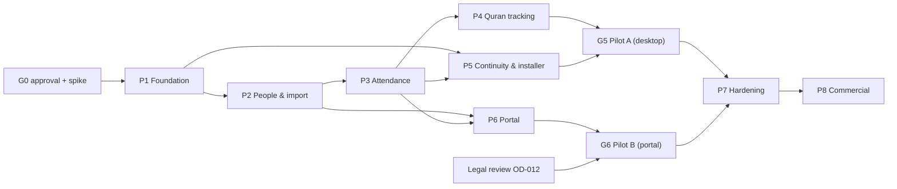

# IMPLEMENTATION_ROADMAP.md

**Accountable role:** CTO + Product Manager · **Status:** Batch 4 draft · **Date:** 2026-11-20

**Definition of Done:** phases are ordered by validated dependencies; every phase has scope (by REQ), exit criteria, tests, and a gate; the critical path and the first 30 days are explicit; effort is expressed as **rough sizes with stated assumptions**, not promises; what is deliberately *not* built is listed; nothing starts before the approval gates.

**Status legend:** **C** Confirmed · **R** Recommended · **U** Unresolved (named OD) · **F** Future.

---

## 1. Assumptions (all unvalidated until OD-006 / OD-007 are answered)

| Assumption | Source |
|---|---|
| One builder, assisted by AI, working most of the week | OD-007 default |
| Stack = TypeScript end-to-end (ADR-003 approved) | C |
| Pilot = one association, 200+ students, two branches, one PC | C |
| Release 1 = desktop + read-only guardian portal; no Android | C |
| Sizes below are **order-of-magnitude** and will be re-estimated after the spike and after the first phase | R |

**Size key:** **S** ≈ a few days · **M** ≈ 1–2 weeks · **L** ≈ 3–5 weeks · **XL** ≈ more than 5 weeks. These are not commitments. A realistic total for release 1 on the assumptions above is **several months**, dominated by validation with real users, not by typing code.

## 2. Key sequencing decision (changes the earlier plan)

The original brief and the PRD MVP include the guardian portal. Security and legal review (OD-012) make the portal the slowest, riskiest part, and it is **not needed for the association to start benefiting**. Therefore:

- **Pilot Phase A (desktop-only):** the association runs daily operations on the desktop app.
- **Pilot Phase B (portal):** guardians join after the portal passes Gate S2 (security + legal).

The MVP in `PRD.md` §2 is still the *definition of release 1*; this roadmap just lets the pilot start earlier and safer. (R — your decision.)

## 3. Phases

### Phase 0 — Governance, spike, foundations · Size **M**

| Item | Detail |
|---|---|
| Scope | Activate `CLAUDE.md`; approve tooling installs; **spike S1–S4** (SYSTEM_ARCHITECTURE §3.4); repository skeleton (monorepo: `domain`, `app-desktop`, `portal`, `ui`, `tools`); CI on GitHub (tests, lint, dependency-rule check, audit); synthetic data generator; validate workflows with the pilot (OD-006); decide OD-011 follow-ups (shell Electron vs Tauri) |
| Exit criteria | Spike criteria met or ADR-003 reopened; CI green on an empty-but-real pipeline; workflow validation notes merged into `CORE_WORKFLOWS.md`; remaining ODs for Phase 1 answered |
| Tests | CI smoke; dependency-rule test (domain imports nothing); schema envelope scan test |
| **Gate G0** | **Your approval** to start implementation (this is the "approve architecture and roadmap" step of the original brief) |

### Phase 1 — Foundation · Size **L**

| Item | Detail |
|---|---|
| Scope | Domain package skeleton and test harness; SQLite layer, migrations, envelope, scoped repositories; **audit log with hash chain**; authentication (Argon2id, backoff, auto-lock, recovery key flow); roles/permissions × branch; encryption at rest + encrypted backups engine (minimal); app shell (RTL), design-system components; setup wizard (WF-01); policies; Quran reference dataset loader (OD-027) |
| REQs | REQ-001–005, 022, 080, 081 (engine), 083 (stub) |
| Exit criteria | Fresh install → wizard → first backup + **successful restore drill**; authorization matrix tests (incl. negative) green; audit-chain verification green |
| Tests | Domain tests for BR-004, 014, 016, 046, 047; DB constraint tests; security tests SEC-010–016, 020–023, 040–046, 060–062 |
| **Gate G1** | Demo to you; security gate S1 partial (auth, authz, encryption, audit) |

### Phase 2 — People, groups, enrollment, import · Size **L**

| Item | Detail |
|---|---|
| Scope | Students, guardians, staff; groups and teacher assignments; enrollment and **transfers with history**; search/filter on 2,000 rows; archiving; **Excel/CSV import with dry-run (WF-02)**; duplicate warnings; student profile (basic) |
| REQs | REQ-010–017, 020–023 |
| Exit criteria | The pilot's real student list imports (dry-run report understood by staff); BR-001/002/011-prereqs enforced at DB and domain level |
| Tests | Property tests for transfers/overlaps; import fuzzing; UI tests WF-03/04/05; performance budget test with 2,000 students |
| **Gate G2** | Walkthrough with a pilot supervisor on **their** data |

### Phase 3 — Scheduling and attendance · Size **L**

| Item | Detail |
|---|---|
| Scope | Weekly patterns and sessions, holidays (Hijri/Gregorian display), conflict detection; attendance entry (WF-06), confirmation rule (BR-030), corrections (WF-07), absence alerts; attendance reports and paper sheets |
| REQs | REQ-030–032, 040–046, 070–072 (attendance part) |
| Exit criteria | **Parallel run:** staff record attendance in MISHKAT *and* on paper for 2 weeks; discrepancies analyzed |
| Tests | BR-011/024/025/027/028/029/030 domain + DB tests; UI test WF-06 with keyboard; Arabic print check on the pilot printer |
| **Gate G3** | Pilot parallel run reviewed → decision to make MISHKAT the system of record for attendance |

### Phase 4 — Quran tracking and progress · Size **M–L**

| Item | Detail |
|---|---|
| Scope | Memorization records (new/revision/consolidation), range picker, evaluation scale, memorized set by interval union, progress map, group progress, reports |
| REQs | REQ-050–054, 017 (progress part), 070 |
| Exit criteria | Teachers/staff enter a week of real records faster than on paper; examples in `BUSINESS_RULES.md` §12 pass as automated tests |
| Tests | Property tests for BR-032–035; dataset checksum test; UI test WF-08/09 |
| **Gate G4** | Feedback session with a teacher/academic supervisor |

### Phase 5 — Continuity, licensing, installer · Size **M–L**

| Item | Detail |
|---|---|
| Scope | Scheduled backups with verification and restore test mode (WF-14); signed installer; update mechanism with pre-update backup and rollback (WF-19); license file validation and pilot license (WF-18); diagnostics bundle; crash handling; migration-from-previous-version tests |
| REQs | REQ-081–086 |
| Exit criteria | **Install on the pilot PC from the signed installer**, perform an update, break the app on purpose and recover, restore from the off-machine backup |
| Tests | Backup tamper/wrong-tenant tests; update failure/rollback test; license degrade-not-block test (BR-048/049) |
| **Gate G5 = Pilot Phase A starts** | Security gate S1 complete; restore drill passed on the pilot PC; training material ready (Arabic, short, task-based) |

### Phase 6 — Guardian portal · Size **L–XL** (can overlap Phase 5 after G4)

| Item | Detail |
|---|---|
| Scope | Portal app (PWA, mobile-first, Arabic RTL); PostgreSQL + RLS; ingestion API with signed requests; projection/diff/publish (WF-11) incl. epoch/restore handling; guardian onboarding with invite codes (WF-12); announcements (WF-13); account-status feed; publish preview and takedown; observability |
| REQs | REQ-060–066 |
| Exit criteria | Projection/privacy property tests, sync crash/restore tests, RLS tests all green; **legal review (OD-012) done**; external penetration test passed |
| **Gate G6 = Pilot Phase B starts** | Security gate S2 complete; hosting decision (OD-005) made |

### Phase 7 — Pilot hardening · Size **M** (continuous)

Real use for 4+ weeks; bug fixing; performance against budgets; support process; usability observation (time to record attendance, errors); success measures from `PRODUCT_VISION.md` §8; security review of findings; update threat model.
**Gate G7:** success measures met or consciously revised.

### Phase 8 — Commercial readiness · Size **M**

License issuance tooling and policy (OD-018), installer/website distribution, user guide and video basics in Arabic, support/maintenance terms, vulnerability-disclosure contact, pricing, onboarding checklist for new associations. **Gate S3.**

### Candidates after the association's trial (recorded 2026-11-22; none approved)

From an outside observation (see `OPEN_DECISIONS.md` §J). Each needs your decision, informed by the trial feedback; nothing is scheduled yet.

| Order | Candidate | Where it belongs | Size |
|---|---|---|---|
| 1 | OD-053 weekly group schedule | Phase 3 scope (REQ-030), specified but not built | M |
| 2 | OD-054 cancelled session / teacher absence told to guardians | Phase 3 scope (REQ-032); needs OD-053 | S–M |
| 3 | OD-056 weekly follow-up card | Phase 4 reporting (new) | S |
| 4 | OD-057 teacher's note to the guardian | Phase 4 (new); after legal review OD-012 | S |
| 5 | OD-055 announcements on the desktop | Phase 6 scope brought forward (REQ-062, WF-13) | S–M |

Proposed **not** to adopt: OD-058 (student accounts) and OD-059 (self-registration). Sizes are rough, same key as §1.

### After release 1 (Future, in suggested order)

1. Teacher entries from phones via the portal **command inbox** (SYNC §9) (OD-002).
2. Finance module (OD-009).
3. Certificates/ijazah/khatm (OD-010).
4. French UI (OD-004) and multi-association hosting at scale.
5. Optional notifications (OD-016), messaging.
6. Native Android only if the PWA proves insufficient.

## 4. Dependencies and critical path

**Critical path:** G0 → P1 → P2 → P3 → P4 → P5 → G5. **Long-lead items to start early (non-engineering):** legal review (OD-012), code-signing certificate or Store path (SEC-071), a working relationship with the pilot staff (OD-006), a printer test, portal hosting decision (OD-005), penetration-test budget.

## 5. First 30 days (proposed)

| Week | Focus |
|---|---|
| 1 | Approve tooling; run spike S1–S4; walk WF-01/03/06/08/14 with pilot staff using their real sheets; answer remaining ODs for Phase 1 |
| 2 | Repository + CI; domain test harness; DB migrations with envelope + constraints; audit chain; synthetic data generator |
| 3 | Auth + recovery-key flow + roles/branch scope + app shell + design system components |
| 4 | Setup wizard, policies, encrypted backup engine, restore drill; Gate G1 demo |

## 6. Test requirements per phase (summary)

Every phase ships with: domain/property tests for its rules; database constraint tests; authorization tests including negative cases; UI tests for the workflows it delivers; migration tests from every prior release; performance checks against `SYSTEM_ARCHITECTURE.md` §10. **A phase is not complete until these were executed and their results reported** — including failures.

## 7. Risks to the roadmap

| ID | Risk | Mitigation |
|---|---|---|
| RISK-011 | Spike fails a criterion | Fallback paths: Tauri shell, or reopen ADR-003 with you |
| RISK-012 | Pilot staff availability for validation | Schedule fixed sessions per gate; use recorded walkthroughs |
| RISK-013 | Legal review delays the portal | Pilot Phase A does not depend on it |
| RISK-014 | Scope creep (finance, certificates, French) | Anything not in PRD M/S needs a written change decision |
| RISK-015 | Solo builder bottleneck | Small phases, CI, tests as the safety net, AI-assisted review |
| RISK-016 | Arabic print quality surprises on the pilot's printer | Early printer test (Phase 0 S3 and Phase 3) |
| RISK-017 | Single PC failure during pilot | Off-machine backup; restore drill before G5 |

## 8. Explicitly not in release 1

Android app · two-way sync · multi-PC Hybrid mode · finance · certificates/ijazah/khatm · SMS/WhatsApp integration · French UI · hizb/thumn/page tracking · dark mode · multi-association hosting at scale.

## 9. Decisions needed from you, by phase

| Before | Decision |
|---|---|
| Phase 0 | Approve tooling for the spike; OD-006 access to pilot staff; OD-007 team/timeline |
| Phase 1 | OD-013 (student fields), OD-019 (encryption default), OD-028 (auto-lock/MFA), OD-027 (dataset) |
| Phase 3 | OD-017, OD-020, OD-021, OD-026 confirmations |
| Phase 4 | OD-024 pass mark, scale details |
| Phase 6 | OD-005 hosting, OD-012 legal review, OD-015, OD-016 |
| Phase 8 | OD-018 pricing/license terms |

---

**Cross-role review (QA Automation Engineer):** The two parallel runs (attendance in Phase 3, whole system in Pilot A) are the most valuable tests in the plan; they find what no specification can. Budget time for them and treat discrepancies as requirements, not as user error.
