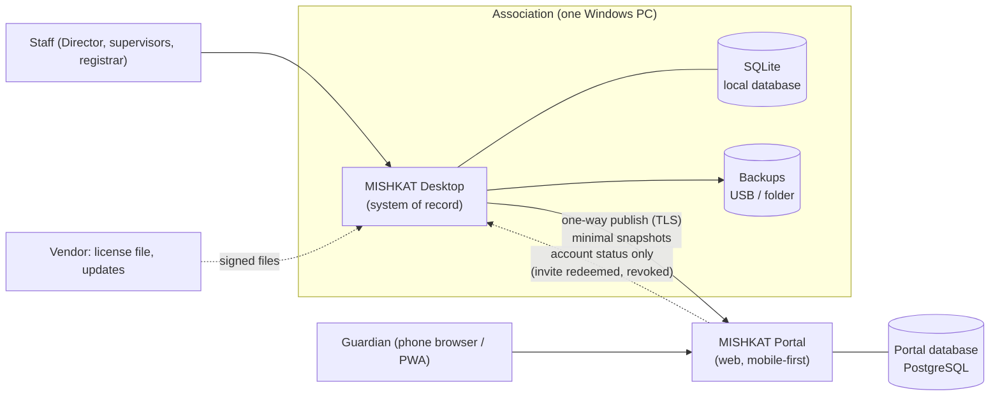
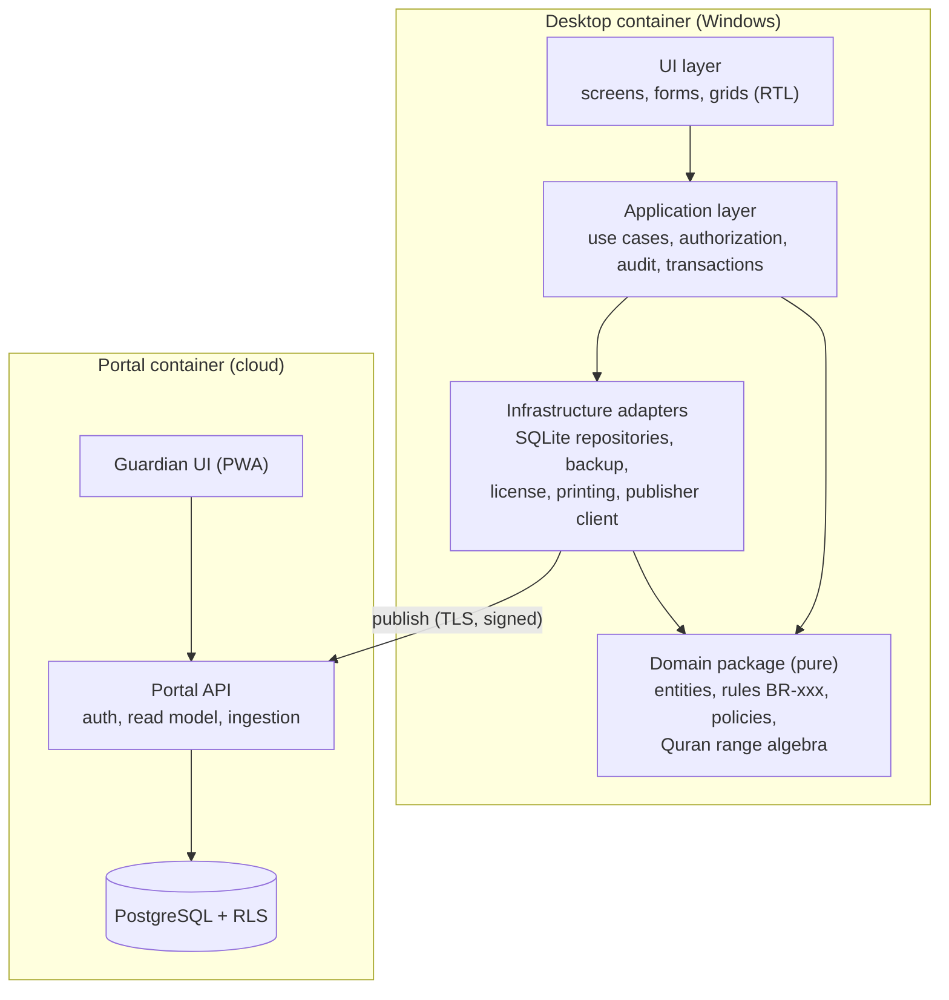

# SYSTEM_ARCHITECTURE.md

**Accountable role:** Software Architect · **Status:** Batch 3 draft · **Date:** 2026-11-20

**Definition of Done:** context and containers are defined; every significant technical choice has an ADR with options and consequences; the stack decision (OD-011) is evidenced and clearly marked as *proposed* pending approval; module boundaries, cross-cutting concerns, deployment, failure modes, and testing are covered; every `VERIFY` item is either checked (with source) or listed as unverified.

**Status legend:** **C** Confirmed by you · **R** Recommended · **P** Proposed — needs your approval at this gate · **U** Unresolved · **F** Future.

---

## 1. Context and constraints

| Item | Value | Status |
|---|---|---|
| Release 1 deliverables | Windows desktop (offline, system of record) + guardian web portal (read-only, mobile-first, Arabic RTL) | C |
| Pilot size / topology | 200+ students, 2 branches, **one PC** | C |
| Sync | One-way, desktop → portal | C (approved) |
| Android app | Not in release 1 | C (approved) |
| Priorities | Management and organization; simple memorization tracking | C |
| Builder profile | Solo developer assisted by AI (OD-007, default) | R |
| Environment today | Windows 11 Home, 16 GB RAM, Node 26, JDK 23 (non-LTS), Git, Android Studio; **no Gradle, no PostgreSQL, no Rust** | verified |

**Quality attributes, ranked:** (1) data integrity and recoverability, (2) correctness of business rules, (3) Arabic text quality and usability, (4) privacy/security of children's data, (5) offline operation, (6) maintainability by a very small team, (7) performance (loads are small), (8) installer size.

## 2. System context

Data ownership: **the desktop owns all association data**. The portal owns only *portal credentials* and *a read-only projection*. See `SYNC_STRATEGY.md` for the ownership matrix.

## 3. Stack decision (OD-011) — evidence and recommendation

### 3.1 Options

| Option | Description |
|---|---|
| **A** | Compose Desktop (Kotlin, JVM) for the desktop; separate web stack for the portal (Spring Boot + a web front end). Matches the original preferred direction. |
| **B** *(proposed)* | **TypeScript end-to-end.** One UI technology (HTML/CSS/React-style components) used for the desktop UI (inside a desktop shell) and for the portal; one pure-TypeScript domain package; portal API in TypeScript. |
| **C** | Compose Multiplatform for both desktop and web (Wasm). |

### 3.2 What was checked (as of 2026-11-20)

| Fact | Finding | Source |
|---|---|---|
| Compose Multiplatform for Web (Wasm) maturity | **Beta** since Compose Multiplatform 1.9.0 (Sept 2025); no stable release announcement found | [JetBrains blog, 1.9.0](https://blog.jetbrains.com/kotlin/2025/09/compose-multiplatform-1-9-0-compose-for-web-beta/) |
| Arabic on Compose for Web | Community threads report wrong glyphs/limited font handling on web | [Kotlin Slack thread](https://slack-chats.kotlinlang.org/t/26922979/hello-does-kmm-compose-web-supports-rtl-such-as-hebrew-arabi) (anecdotal) |
| RTL in Compose Multiplatform | Officially supported via the Unicode bidirectional algorithm; official docs list **no** known limitations | [Kotlin docs: RTL](https://kotlinlang.org/docs/multiplatform/compose-rtl.html) |
| Arabic shaping/tashkeel quality in Compose text | A third-party library claims built-in limitations (cursive joining, diacritic positioning, ligatures); **unverified**, needs our own test | [harfbuzz-kmp](https://klibs.io/project/MohamedRejeb/harfbuzz-kmp) (third-party claim) |
| Room on JVM desktop | Room 3.0 (KMP-focused) released as **alpha** in March 2026; Room 2.x in maintenance mode; bundled SQLite driver exists. **Stable status of Room 3 not confirmed** | [Android Developers Blog](https://android-developers.googleblog.com/2026/03/room-30-modernizing-room.html) |
| Windows packaging for Compose Desktop | MSI/EXE via jpackage; **Windows code signing is left to the developer**; Conveyor is commercial and outputs MSIX; Microsoft Store is an alternative signing path | [Kotlin docs](https://kotlinlang.org/docs/multiplatform/compose-native-distribution.html), community threads (anecdotal) |
| Web-tech desktop shells | Tauri 2 installers are very small (a few MB, uses system WebView2); Electron bundles Chromium (~100 MB class) with more mature packaging/auto-update; ratios vary by source | secondary blogs, rough only |

**Not verified (no spike run, no tools installed):** real Arabic rendering in Compose Desktop on the pilot's PC; Electron/Tauri installer sizes for this app; SQLite driver behavior inside the shell; printing quality of Arabic PDFs. These are listed in the spike plan (§3.4).

### 3.3 Assessment

| Criterion (weight) | A: Compose Desktop + web | B: TypeScript end-to-end | C: Compose for both |
|---|---|---|---|
| Arabic text and tashkeel quality (high) | Unverified; some risk | Browser-grade shaping, bidi, fonts; lowest risk | Desktop unverified; web known issues |
| Number of UI codebases (high) | Two | **One** (shared components) | One |
| Portal on a phone, PWA (high) | Needs separate web stack | **Native fit** | Beta technology |
| Reuse of my design deliverable (the HTML prototype) | Re-implemented in Compose | **Reused directly** | Re-implemented |
| Toolchain needed on this PC | Gradle (+ JDK LTS) to install | Node already present; Electron adds none | Gradle |
| Installer size / memory (medium) | Moderate (bundled JRE) | Electron: larger; Tauri: small but needs Rust toolchain | Moderate |
| Data grids / reports / printing PDF | Custom work | Mature libraries; print-to-PDF with Arabic via browser engine | Custom work |
| Ability to drive and verify UI automatically in this environment | Harder | **Browser automation available** | Harder |
| Alignment with the original "preferred direction" | **Full** | Deviation | Partial |
| Future native Android reuse of domain code | Good (KMP) | Domain would be reimplemented; PWA covers phones | Good |
| Ecosystem/hiring/long-term maintainability for one developer | Good | **Very good** | Younger ecosystem |

### 3.4 Recommendation (ADR-003 — **Option B approved by the user on 2026-11-20**; the spike below is still required before feature work)

**Choose Option B**, with a time-boxed **spike (1–2 days)** before any feature work to validate the three things we could not verify. Rationale in one paragraph: the release needs *two* user interfaces; the web portal has to be web technology anyway; Arabic text quality is the biggest experience risk; Compose for Web is still beta; and a single stack halves the UI work for a solo builder, lets the approved HTML design prototype become real code, and lets every screen be verified automatically here. The cost is a deviation from the original preferred direction, a larger installer (Electron) and re-implementing domain code if a native Android app is ever built.

**Spike plan (needs your approval to install tooling):**

| # | Question | Pass criterion |
|---|---|---|
| S1 | Arabic text with tashkeel, mixed Arabic/Latin/digits, in a 2,000-row table | Correct shaping and bidi; scrolling smooth; no font fallback errors on the pilot PC |
| S2 | Desktop shell + SQLite (WAL) + online backup + verified restore | Works offline; backup/restore round trip passes integrity check |
| S3 | PDF/print of an Arabic attendance sheet on the pilot's printer | Output legible, RTL correct, page breaks sane |
| S4 | Installer build, size, silent update path, signing options | Installer size acceptable (< ~200 MB proposed), signed build produced or Store path understood |
| S5 | (Only if the user prefers Option A) same S1 and S3 in Compose Desktop | Same criteria |

**Addendum (approved by the user 2026-11-20, from SPIKE_REPORT Update 3):** the desktop app **disables hardware acceleration by default** (`app.disableHardwareAcceleration()`); the UI is tables and forms. Phase 0 adds a visible-window smoke test of the packaged build on the pilot PC. Cause of the GPU failure on the dev PC is not established; revisit if a feature needs GPU.

**Decision:** Option B approved; spike tooling approved and installed in `spike/` only (results: `SPIKE_REPORT.md`). If the spike fails a criterion, ADR-003 is reopened — the desktop *shell* (Electron vs Tauri) may change, and in the worst case the decision returns to you.

## 4. Container view (Option B shown; layering is stack-independent)

**Layer rules (enforced by lint/dependency tests):** UI → Application → Domain; Infrastructure implements Domain ports; **Domain imports nothing** (no database, no UI, no clock, no random — they are injected). Branch and tenant scoping is applied in the Application layer and repositories, never only in UI.

## 5. Modules (modular monolith)

| Module | Responsibility | Depends on |
|---|---|---|
| `association` | Association, branches, academic years, holidays, policies | — |
| `people` | Persons, students, guardians, staff, consent | association |
| `access` | Accounts, roles, branch-scoped permissions, sessions, lockout | people |
| `groups` | Groups, teacher assignments, rooms | association, people |
| `enrollment` | Enrollments, transfers, capacity, history | groups, people |
| `scheduling` | Weekly patterns, sessions, conflicts | groups, association |
| `attendance` | Attendance records, corrections, confirmation | enrollment, scheduling |
| `tracking` | Quran dataset access, memorization records, range algebra, evaluations | enrollment, association |
| `reporting` | Read-only queries, exports, printable documents | all read models |
| `publishing` | Projection, diff, delivery to the portal, account-status intake | all read models |
| `governance` | Audit log (hash-chained), consent log, export history | cross-cutting |
| `continuity` | Backup, verify, restore, update, migrations, import | cross-cutting |
| `licensing` | License file validation, entitlements | cross-cutting |

No module reaches into another's tables; cross-module access goes through application-level interfaces. Reporting uses read-only queries by design.

## 6. Architecture decision records

| ADR | Decision | Status |
|---|---|---|
| ADR-001 | Desktop is the **single authority** for association data; one-way publish to the portal | C |
| ADR-002 | Modular monolith with clean/hexagonal layering; pure domain package | R |
| ADR-003 | TypeScript end-to-end (Option B), desktop shell decided by spike (Electron default, Tauri candidate) | **C — approved by the user 2026-11-20** (spike still pending) |
| ADR-004 | Local database: **SQLite** (WAL, foreign keys on, STRICT tables), SQL migrations as plain files, a typed query builder rather than a heavy ORM (library choice VERIFY at implementation) | R |
| ADR-005 | Identifiers **UUIDv7 (text)**, timestamps in **UTC**, dates as local `YYYY-MM-DD`, soft delete (tombstones), `version` counter on every row (BR-046) | C (brief) / R (formats) |
| ADR-006 | Authorization = **role × branch scope**, checked in the Application layer and enforced by repository filters; deny by default; unit tests per matrix row | R |
| ADR-007 | **Audit log**: append-only, each entry stores the hash of the previous entry (tamper-evident); verification routine | R |
| ADR-008 | Quran text/reference as a **bundled, versioned, read-only dataset** with checksum; records store the dataset version and global ordinal plus exact surah:ayah (BR-012, BR-038); source and license = OD-027 | R |
| ADR-009 | Portal = stateless web app + managed PostgreSQL with **row-level security by tenant**; hosting provider agnostic until OD-005/OD-012 | R |
| ADR-010 | Backups use SQLite's **online backup API**, written to a temp file, verified (integrity check + row counts), then moved into place; encryption/keys per OD-019 | R |
| ADR-011 | Licensing: **offline signed license file** (public-key signature); design in Batch 4 | R |
| ADR-012 | Reports/printing: **HTML → PDF through the engine's print-to-PDF** (best Arabic fidelity); Excel via a library (choice at implementation) | R (VERIFY in spike S3) |
| ADR-013 | Time and calendars: store Gregorian; compute Hijri for display with a configurable day-adjustment; **holidays are stored as confirmed Gregorian dates** (moon sighting is human input) | R |
| ADR-014 | Packaging and updates: signed installer; update mechanism chosen after spike S4; **backup before migration** (BR-043) | R (VERIFY) |
| ADR-015 | No microservices; no message broker; publishing uses a local outbox/state-diff, not a distributed queue | R |

## 7. Cross-cutting concerns

| Concern | Approach |
|---|---|
| **Authorization** | `can(user, action, resource)` evaluated in Application services; branch scope derived from the resource's own `branch_id`; negative tests mandatory (see roles doc §7) |
| **Audit** | Every sensitive use case emits an audit entry in the **same transaction** as the change; failure to audit fails the operation |
| **Transactions** | One use case = one database transaction; domain returns results/events, infrastructure persists |
| **Errors** | Typed domain errors with Arabic user messages and stable codes; no raw exceptions in the UI; every error screen offers a next step |
| **Logging** | Structured logs, **no personal data** (ids only); rotating files; "diagnostics bundle" excludes data (REQ-086) |
| **Configuration** | Policies are data (BR §11), versioned, audited; no hard-coded business parameters |
| **i18n / RTL** | All strings externalized (Arabic now, French possible later, OD-004); layout uses logical (start/end) properties; Quran text uses its own font and no UI-font fallback |
| **Time** | Clock injected; association timezone stored (default Africa/Algiers); never trust the portal's clock for domain decisions |
| **Accessibility** | WCAG AA contrast, keyboard-first flows on desktop, scalable text (NFR-008) |
| **Privacy** | Minimum data (BR-022); portal gets projections only (BR-042); consent records |
| **Secrets** | No secrets in the repository; device/portal keys stored with OS-protected storage (Batch 4 detail) |

## 8. Deployment view

| Environment | What | Notes |
|---|---|---|
| Developer machine | Source, tests, spike | Windows 11 (current) |
| CI | GitHub Actions (Windows runner for installer builds) | Tests, lint, dependency rules, build, signing step when certificate exists |
| Association PC | Installed desktop app, local SQLite, backups | Single operator at a time (OD-006 to confirm) |
| Portal (staging/production) | Web app + PostgreSQL | Provider and region pending OD-005/OD-012; keep portability |
| Releases | Versioned installers + signed license files | Update channel decided in S4 |

## 9. Failure modes and responses

| Failure | Effect | Response |
|---|---|---|
| Internet down | Portal not updated | Queue changes, non-blocking banner "N changes not yet published" |
| Portal down | Same | Retry with backoff (see sync doc) |
| PC loses power mid-write | Possible partial transaction | SQLite WAL + transactions; integrity check on start; automatic restore offer from last verified backup |
| Disk failure / PC replaced | Total loss risk | Backup destination off-machine is **strongly recommended in the setup wizard**; restore on new PC; license transfer policy (OD-018) |
| Update fails | App unusable | Pre-update backup; automatic rollback of binary + DB copy (BR-043) |
| Corrupt backup | Silent false safety | Backup verification + periodic restore test (REQ-081) |
| Wrong data published | Privacy incident | Unpublish tool (BR-041); publish preview for the first run |
| Lost admin password | Lock-out | Recovery key / second admin (OD-014) |
| Clock changed manually | Wrong dates | Warn on large clock jumps; audit entries record both entry time and effective date |

## 10. Performance budgets (proposed; to confirm in spike)

| Metric | Budget |
|---|---|
| Cold start to usable screen | ≤ 5 s on a 4 GB PC |
| Student search/filter (2,000 rows) | ≤ 300 ms (SQLite + indexes) |
| Attendance screen for 30 students | renders ≤ 200 ms; save ≤ 300 ms |
| Report for a year of attendance (200 students) | ≤ 3 s |
| Backup (200 students, 3 years) | ≤ 10 s and a few MB |
| Portal main view on mobile | ≤ 3 s first load (NFR-009) |

Expected data scale is tiny for SQLite (≈ 25–30k attendance rows per year for the pilot).

## 11. Testing architecture

| Level | Scope | Rule |
|---|---|---|
| Domain unit/property tests | Every BR marked **D**: overlaps, unions, transfers, correction windows | Run in milliseconds, no I/O |
| Repository/DB tests | Constraints (BR-001, BR-011, BR-027, audit append-only), migrations up/down on real SQLite | Real DB, no mocks |
| Application tests | Authorization matrix incl. **negative branch tests**, audit emission, atomicity | In-memory time/clock |
| Migration tests | Upgrade from every released schema version with sample data | Mandatory before each release |
| Sync tests | Delta/diff, retries, idempotence, restore-epoch case | Fake portal + real portal in CI |
| Portal tests | Tenant isolation, guardian scoping (BR-040), RLS | Real PostgreSQL |
| UI tests | Critical workflows WF-01/03/06/08/14 via browser automation, RTL screenshot checks | Run in CI |
| Accessibility | Automated contrast + keyboard checks | Per release |
| Performance | Budget tests with generated data (2,000 students) | Per release |

Tests are executed before any claim of success; failures are reported, not suppressed.

## 12. Risks specific to the architecture

| ID | Risk | Mitigation |
|---|---|---|
| RISK-006 | Stack decision made on unverified assumptions | Spike S1–S4 before feature work |
| RISK-007 | Native module issues (SQLite binding) inside the desktop shell | Spike S2; pin versions; CI builds the installer on Windows |
| RISK-008 | Deviation from the original Kotlin direction is a business risk (skills, partners) | Explicit ADR approval; domain stays framework-free and documented |
| RISK-009 | Single PC = single point of failure | Backup destination off-machine; restore drills |
| RISK-010 | Portal exposes children's data | Minimal projection, consent, RLS, threat model (Batch 4), legal review (OD-012) |

## 13. Unresolved items

OD-005 (hosting/region), OD-011 (stack, this document), OD-019 (backup destinations/encryption), OD-027 (Quran dataset source/license), OD-012 (legal).

---

**Cross-role review (DevOps Engineer):** Two things are easy to forget and expensive later: (1) a **code-signing certificate** or Store path for Windows — without it, users see security warnings that damage trust; (2) a **restore drill** before the pilot starts. Both are scheduled as roadmap items in Batch 4.
